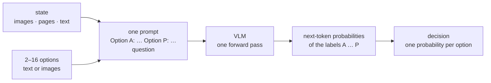

<div align="center">

# VLM-as-Jev

**Typed decisions with probabilities from any vision-language model, over any visual input, in one forward pass**

[](LICENSE)
[](pyproject.toml)
[](#-citation)

**Zhuchenyang Liu** &nbsp;·&nbsp; **Yao Zhang** &nbsp;·&nbsp; **Yu Xiao**
<br>
<sub>Aalto University</sub>

[⚡ Quickstart](#-quickstart) · [🧠 How it works](#-how-it-works) · [📊 Results](#-results-reranking-for-multimodal-retrieval) · [🔁 Reproduce](#-reproduce) · [🤝 Contributing](#-contributing)

</div>

Give a vision-language model a **state** (images, document pages, text, or a mix) and a **typed question**: a choice
among 2 to 16 options, or a yes/no question. The options can be text or images. They go into one prompt under the
labels **A–P**, and the next-token probabilities of the labels are the decision: one probability per option, read
from one forward pass. No training, no decoding, no parsing. This is the interface of Jev-style System One models,
read from an off-the-shelf VLM.

Our technical report applies it to one problem, **reranking for multimodal retrieval**: the options are the
candidate images or pages of a first-stage retriever, and the probabilities rank them. The results below are from
that setting.

## ⚡ Quickstart

```bash
pip install -e ".[client]"            # the library, plus the tokenizer that maps labels to token ids
```

Serve a vision-language model with [vLLM](https://github.com/vllm-project/vllm). `processed_logprobs` makes the server
return the log-probability of every label:

```bash
vllm serve Qwen/Qwen3.8-27B --logprobs-mode processed_logprobs \
    --max-model-len 65536 --limit-mm-per-prompt '{"image": 20}'
```

**A decision about an image**

```python
from PIL import Image
from vlm_as_jev import ChatBackend, Decider

jev = Decider(ChatBackend("http://127.0.0.1:8000", model="Qwen/Qwen3.8-27B"))

d = jev.choice(state=[Image.open("intersection.jpg"), "Traffic camera, 08:14."],
               question="What should the operator do?",
               options=["nothing", "send police", "send an ambulance"])
d.answer                   # the most probable option
d.probs                    # one probability per option, in the given order; they sum to 1

jev.yes_no(Image.open("shelf.jpg"), "Is any product out of stock?")      # probability of "yes"
```

Options can be images too, for instance *which of these photos shows the same product?*:
`jev.choice(state=query_photo, question=..., options=[photo_1, photo_2, photo_3])`. A state or an option is a string,
an image, a dict with `"image"` (one or a list) and `"text"`, or a list of these. Images are downscaled to
1800 × 32 × 32 pixels before they are sent.

**Reranking** (the setting of the technical report)

```python
from vlm_as_jev import Reranker

reranker = Reranker(ChatBackend("http://127.0.0.1:8000", model="Qwen/Qwen3.8-27B"))
pages = [Image.open(f"page_{i}.png") for i in range(16)]       # the first-stage top-16, best first
r = reranker.rerank("What was the operating margin in 2023?", pages,
                    instruction="Find a document image that matches the given query.")
r.order      # candidate indices, best first
r.scores     # one probability per candidate, in input order
```

`Reranker(..., readout="pointwise")` asks one yes/no question per candidate instead, the readout of supervised
rerankers such as Qwen3-VL-Reranker.

<details>
<summary><b>On JEV-27B-VL's System One endpoint</b></summary>

[autotrust/JEV-27B-VL](https://huggingface.co/autotrust/JEV-27B-VL) adds a decision head to Qwen3.8-27B and serves it
at `POST /v1/decide`. Start its server as the model card describes, then use it in place of `ChatBackend`:

```python
from vlm_as_jev import Decider, JevDecideBackend

jev = Decider(JevDecideBackend("http://127.0.0.1:8000"))
```

</details>

## 🧠 How it works



Restricting the next-token distribution to the label tokens gives

$$p(o_j \mid s, q) = \frac{\exp z_{\ell_j}}{\sum_{k=1}^{K} \exp z_{\ell_k}},$$

where $z$ are the next-token logits and $\ell_j$ is the token of the label of option $j$. Because every option is
in the prompt, the model compares them. For reranking, the state is the query, the options are the candidates
(`Candidate A:` … `Candidate P:`), and candidates are ranked by $p$; ties and candidates below the top 16 keep their
first-stage order.

| readout | prompts | what is read |
|---|:---:|---|
| `choice` (listwise) | 1 | P(label) over A…P at the first answer token |
| `yes_no` (pointwise) | 1 per question | P(yes) against P(no) at the first answer token |

## 📊 Results: reranking for multimodal retrieval

Every reranker refines the same top-16 of [Qwen3-VL-Embedding-2B](https://huggingface.co/Qwen/Qwen3-VL-Embedding-2B)
and sees images at the same budget. MMEB-V2 follows the evaluation code of Qwen3-VL-Embedding (hit@1 for image, nDCG@5
for visual documents, mean over tasks). ViDoRe V3 pools the six languages within each dataset and averages nDCG@10
over the eight datasets. A cell with "—" is still running.

| reranker | trained for reranking | MMEB-V2 image<br><sub>hit@1, 12 tasks</sub> | MMEB-V2 visdoc<br><sub>nDCG@5, 24 tasks</sub> | ViDoRe V3<br><sub>nDCG@10, 8 datasets</sub> |
|:--|:--:|:--:|:--:|:--:|
| Qwen3-VL-Embedding-2B | first stage | 74.85 | 79.20 | 53.01 |
| Qwen3-VL-Reranker-2B | yes | 74.49 | 82.72 | — |
| Qwen3-VL-Reranker-8B | yes | 78.36 | — | — |
| VLM-as-Jev, Qwen3.8-27B | no | 76.76 | — | —&nbsp;<sup>†</sup> |
| VLM-as-Jev, JEV-27B-VL | decision tuning on text | 76.80 | — | — |

<sub>† Qwen3.8-27B was run on the English ViDoRe V3 queries only; the English comparison is below.
Source: `bench/results/mmeb_v2.json`, `bench/results/vidore_v3.json`.</sub>

**ViDoRe V3, English queries** (nDCG@10, mean over 8 datasets)

| reranker | ViDoRe V3 English |
|:--|:--:|
| Qwen3-VL-Embedding-2B | 56.08 |
| Qwen3-VL-Reranker-2B | — |
| Qwen3-VL-Reranker-8B | — |
| VLM-as-Jev, Qwen3.8-27B | — |
| VLM-as-Jev, JEV-27B-VL | — |

**Readout and decision tuning** (MMEB-V2 image, hit@1, the same top-16; the first stage scores 74.85)

| backbone | listwise, 1 prompt | pointwise, 16 prompts |
|:--|:--:|:--:|
| Qwen3.8-27B | 76.76 | — |
| JEV-27B-VL | 76.80 | 71.42 |

**Latency** on one NVIDIA H200 at concurrency 1: wall time per query from request to scores, preprocessing included,
for the same top-16 ViDoRe V3 pages (100 English queries, about 29k input tokens per query).

| reranker | model calls | seconds / query |
|:--|:--:|:--:|
| Qwen3-VL-Reranker-2B | 16 | 2.75 |
| Qwen3-VL-Reranker-8B | 16 | 3.67 |
| VLM-as-Jev, Qwen3.8-27B | 1 | 3.97 |
| VLM-as-Jev, JEV-27B-VL | 1 | 4.48 |
| Qwen3.8-27B, pointwise | 16 | 3.10 |
| JEV-27B-VL, pointwise | 16 | 3.57 |

<sub>Qwen3-VL-Reranker runs with its released code (bf16, FlashAttention-2), which scores the 16 pairs one after
another. The 27B models run on vLLM 0.30.0; the pointwise readout sends its 16 requests at once. Source:
`bench/results/latency.json`.</sub>

Every number in this README is read from `bench/results/`, and `tests/test_readme_numbers.py` checks that the
tables match. Per-task numbers are in the same files.

## 🔁 Reproduce

1. **First stage.** Run Qwen3-VL-Embedding-2B with the evaluation code of
   [Qwen3-VL-Embedding](https://github.com/QwenLM/Qwen3-VL-Embedding) (commit `393e297`) on MMEB-V2, and with
   `scripts/eval_vidore3.py emb` on ViDoRe V3.
2. **Supervised rerankers.** Run the repository's `eval_reranker` (MMEB-V2) and `scripts/eval_vidore3.py rr` (ViDoRe
   V3) at top-16. With transformers 5, apply `patches/qwen3vl_reranker_tf5_compat.patch` to the Qwen repository first.
3. **VLM-as-Jev.** Serve the model, then run `scripts/eval_mmeb.py` and `scripts/eval_vidore3.py rerank`.
4. **Score and summarize.** `scripts/eval_vidore3.py score`, then `scripts/summarize.py` writes `bench/results/`.

Commands, server flags and run times are in [docs/reproduce.md](docs/reproduce.md).

## 📁 Repository layout

```
vlm_as_jev/            the library: Decider (choice, yes_no), Reranker, prompts, backends
                       (vLLM chat endpoint, JEV /v1/decide, a fake one for tests)
scripts/               eval_mmeb.py, eval_vidore3.py, latency.py, summarize.py
bench/results/         every reported number, per task, as JSON
patches/               the transformers-5 fix for Qwen3-VL-Reranker's released code
docs/                  reproduce.md, limitations.md
tests/                 unit tests (CPU, no model) and the README number check
```

## ⚠️ Limitations

The technical report measures one use of the readout, reranking; other decisions run through the same code and we
report no numbers for them. A choice has at most 16 options, and its answer can depend on their order; for reranking
we keep the first-stage order and have not measured that dependence for images. The zero-shot models are larger than
the supervised rerankers they are compared with. More in [docs/limitations.md](docs/limitations.md).

## 🤝 Contributing

Issues and pull requests are welcome. A new backend is one file with two methods; see
[CONTRIBUTING.md](CONTRIBUTING.md) and the open items in [ROADMAP.md](ROADMAP.md). Changes are listed in
[CHANGELOG.md](CHANGELOG.md).

## 📝 Citation

The technical report will be on arXiv soon. Until then:

```bibtex
@techreport{liu2026vlmasjev,
  title       = {VLMs as Zero-Shot System One Rerankers for Multimodal Retrieval},
  author      = {Liu, Zhuchenyang and Zhang, Yao and Xiao, Yu},
  institution = {Aalto University},
  year        = {2026}
}
```

## License

Apache-2.0, see [LICENSE](LICENSE). Models and datasets keep their own licenses, see [THIRD_PARTY.md](THIRD_PARTY.md).

<sub>VLM-as-Jev is an independent research project. It is not affiliated with TypeSafe AI, the makers of Jev, or with
autotrust, the authors of JEV-27B-VL.</sub>
