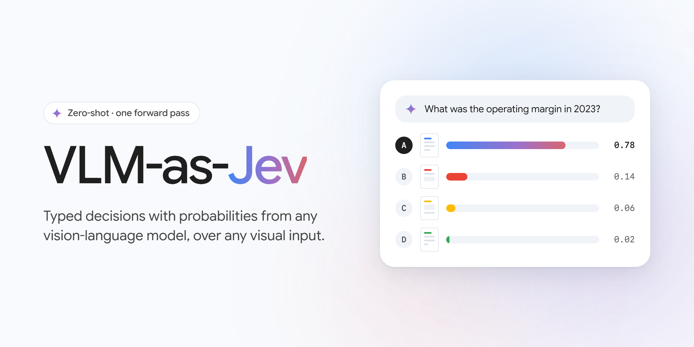
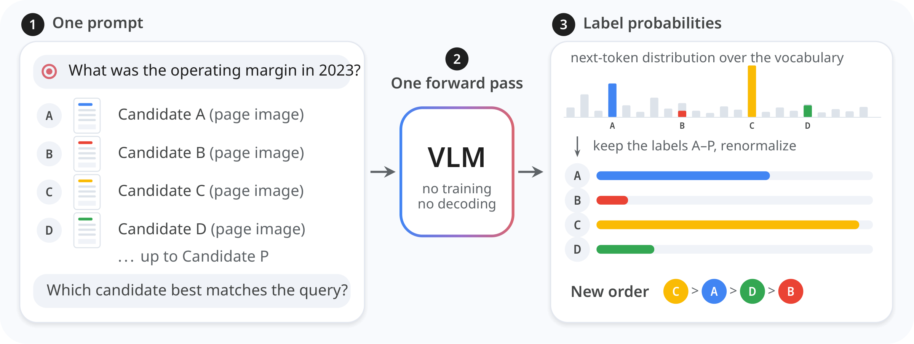
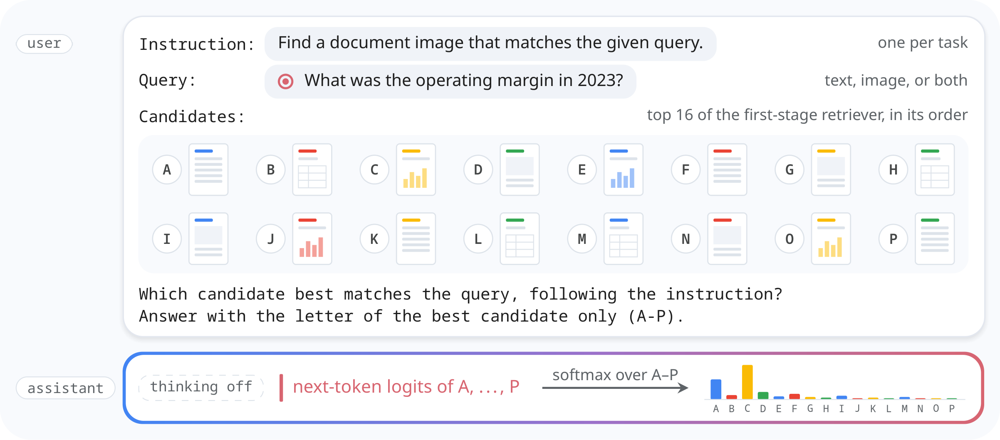

<p align="center">
  
</p>

<p align="center">
  <a href="#citation"></a>
  <a href="LICENSE"></a>
  <a href="https://github.com/Ryenhails/GlanceRank/actions/workflows/ci.yml"></a>
</p>

GlanceRank ranks images and document pages with one forward pass of an off-the-shelf vision-language model. The query
and up to 16 candidates go into one prompt under the labels **A–P**, and the next-token probabilities of the labels are
the ranking. There is no training, no decoding and no reasoning step: the model compares the candidates at a glance,
which is what System One means here. Our technical report uses it to rerank the top-16 of a first-stage retriever.

## How it works

<p align="center"></p>

1. **One prompt.** The query and every candidate go into one prompt, each candidate under a label from A to P.
2. **One forward pass.** The model reads the prompt once and generates nothing.
3. **Label probabilities.** The next-token distribution, restricted to the label tokens and renormalized, gives one
   probability per candidate. The candidates are sorted by it.

Because all candidates share one prompt, the model compares them with each other. The pointwise alternative asks one
yes/no question per candidate, the readout of supervised rerankers such as Qwen3-VL-Reranker.

<p align="center"></p>

The prompt, simplified: one user turn holds the instruction, the query and the candidates, each after its label, and
the question. The assistant turn opens with thinking off, and the next-token logits at that position are read for the
labels A–P. Chat-template tokens are omitted; `glancerank/ranker.py` builds the exact prompt.

## Quickstart

```bash
pip install -e ".[client]"
vllm serve Qwen/Qwen3.8-27B --logprobs-mode processed_logprobs \
    --max-model-len 65536 --limit-mm-per-prompt '{"image": 20}'
```

```python
from PIL import Image
from glancerank import ChatBackend, Ranker

ranker = Ranker(ChatBackend("http://127.0.0.1:8000", model="Qwen/Qwen3.8-27B"))

pages = [Image.open(f"page_{i}.png") for i in range(16)]          # a first-stage top-16, best first
r = ranker.rank("What was the operating margin in 2023?", pages,
                instruction="Find a document image that matches the given query.")
r.order      # candidate indices, best first
r.scores     # one probability per candidate, in input order; they sum to 1
```

A query or a candidate is a string, an image, a dict with `"image"` and `"text"`, or a list of these. Images are
downscaled to 1800 × 32 × 32 pixels. `Ranker(..., readout="pointwise")` asks one yes/no question per candidate
instead. JEV-27B-VL, a Jev-style decision model on the same backbone, can be queried through its own decision head
with `JevDecideBackend("http://127.0.0.1:8000")`.

## Results

From the technical report. Every reranker refines the same top-16 of Qwen3-VL-Embedding-2B and sees images at the same
budget.

| | MMEB-V2 image<br><sub>hit@1 · 12 tasks</sub> | MMEB-V2 visdoc<br><sub>nDCG@5 · 24 tasks</sub> | ViDoRe V3<br><sub>nDCG@10 · 8 datasets</sub> |
|:--|:--:|:--:|:--:|
| Qwen3-VL-Embedding-2B (first stage) | 74.85 | 79.20 | 53.01 |
| *Supervised rerankers* | | | |
| Qwen3-VL-Reranker-2B | 74.49 | 82.72 | 59.18 |
| Qwen3-VL-Reranker-8B | 78.36 | 84.78 | 61.98 |
| *Jev-style decision model* | | | |
| JEV-27B-VL, decision head | 76.80 | 85.42 | 62.03 |
| *Ours, zero-shot* | | | |
| **GlanceRank** (Qwen3.8-27B) | 76.76 | 84.79 | 60.94 |

<sub>ViDoRe V3 pools its six languages within each dataset.</sub>

**Listwise or pointwise, with or without decision tuning** (MMEB-V2 image, hit@1; the first stage scores 74.85; the
listwise cell of Qwen3.8-27B is GlanceRank)

| backbone | listwise · 1 prompt | pointwise · 16 prompts |
|:--|:--:|:--:|
| Qwen3.8-27B | 76.76 | 69.50 |
| JEV-27B-VL | 76.80 | 71.42 |

<details>
<summary><b>Latency</b> on one H200</summary>

<br>

Wall time per query from request to scores, preprocessing included, at concurrency 1: the same top-16 ViDoRe V3 pages
for 100 English queries, about 29k input tokens per query. Qwen3-VL-Reranker runs with its released code, which scores
the 16 pairs one after another; the 27B models run on vLLM 0.30.0.

| reranker | model calls | seconds / query |
|:--|:--:|:--:|
| Qwen3-VL-Reranker-2B | 16 | 2.75 |
| Qwen3-VL-Reranker-8B | 16 | 3.67 |
| GlanceRank (Qwen3.8-27B) | 1 | 3.97 |
| JEV-27B-VL, decision head | 1 | 4.48 |
| Qwen3.8-27B, pointwise | 16 | 3.10 |
| JEV-27B-VL, pointwise | 16 | 3.57 |

</details>

Every number above is read from [`bench/results/`](bench/results), which also holds the per-task scores, and
`tests/test_readme_numbers.py` checks the tables against it. Commands, versions and run times:
[docs/reproduce.md](docs/reproduce.md). Known limits: [docs/limitations.md](docs/limitations.md).

## Contributing

Issues and pull requests are welcome. A backend is one file with two methods; see [CONTRIBUTING.md](CONTRIBUTING.md)
and [ROADMAP.md](ROADMAP.md).

## Citation

```bibtex
@techreport{liu2026glancerank,
  title       = {VLMs as Zero-Shot System One Rerankers for Multimodal Retrieval},
  author      = {Liu, Zhuchenyang and Zhang, Yao and Xiao, Yu},
  institution = {Aalto University},
  year        = {2026}
}
```

## License

Apache-2.0. Models and datasets keep their own licenses ([THIRD_PARTY.md](THIRD_PARTY.md)).

<sub>An independent research project, not affiliated with TypeSafe AI (Jev) or autotrust (JEV-27B-VL).</sub>
